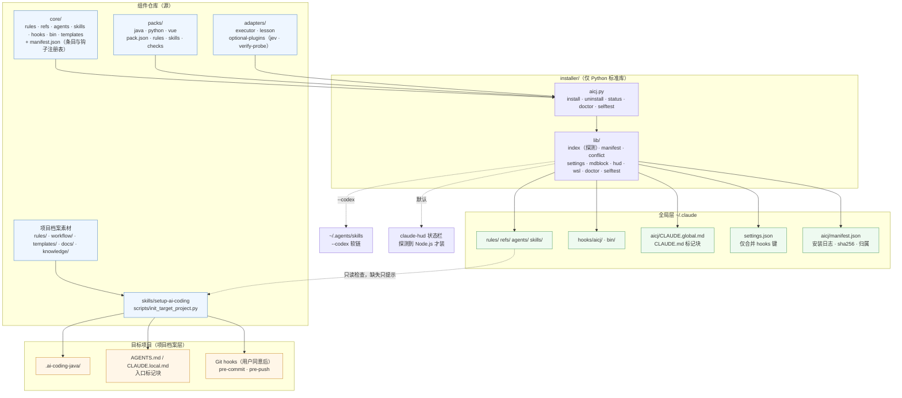
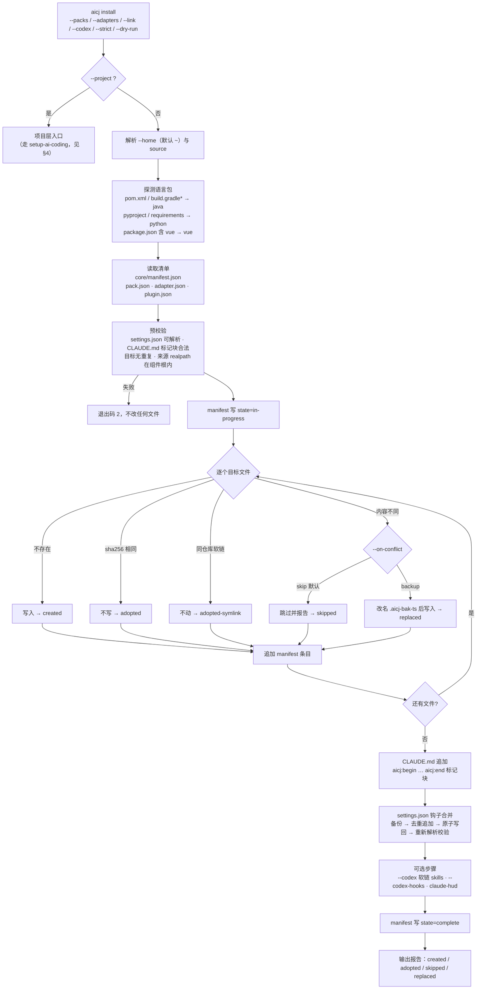
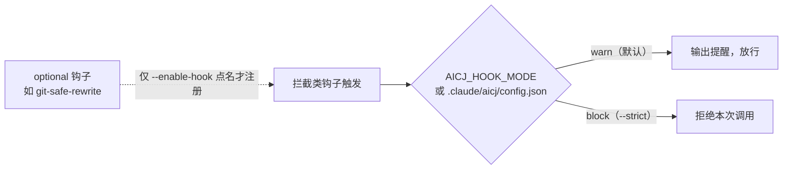
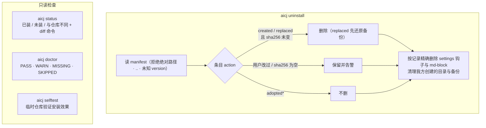
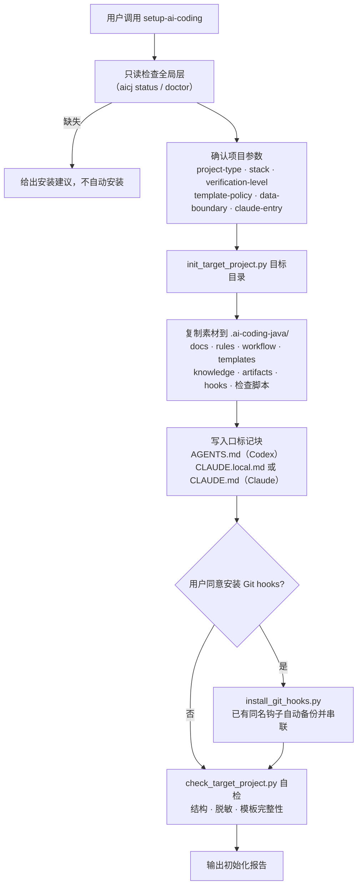
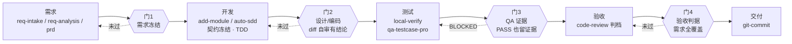
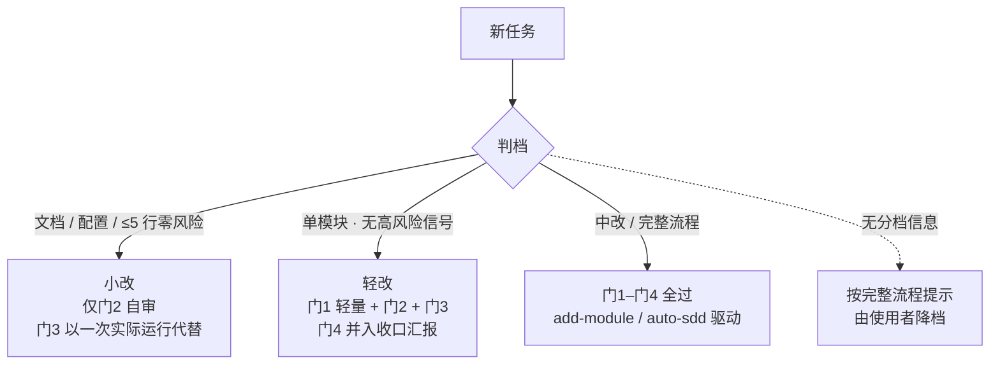
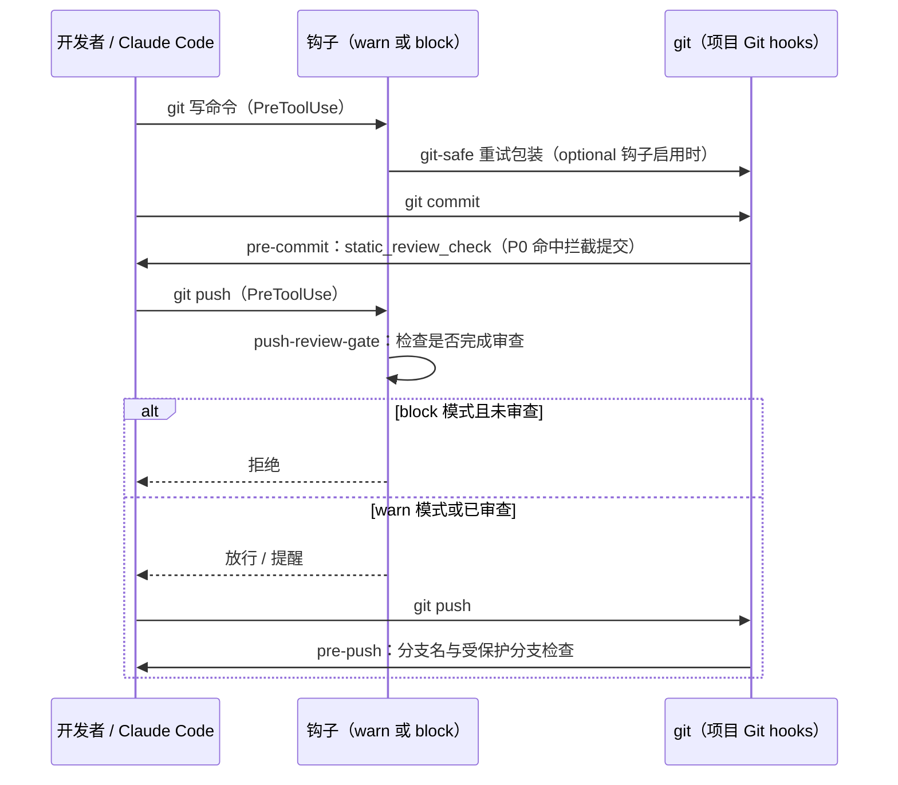

# 架构图与流程图

本文用 Mermaid 描述 ai-coding-java 的组成与运行流程。安装行为的权威契约是 [全局安装设计](docs/global-install-design.md)，阶段门见 [阶段门设计](docs/lifecycle-gates-design.md)；图与文字冲突时以这两份为准。

## 1. 总体架构

组件分两层：**全局层**把规则、角色、skills、钩子装进用户的 `~/.claude`；**项目档案层**往目标项目写 `.ai-coding-java/` 与入口标记块。

### 目录职责

| 目录 | 职责 |
|---|---|
| `core/` | 语言无关：常驻规则、按需 refs、角色（pm/sa/dev/qa/scanner）、通用 skills、钩子、`git-safe` |
| `packs/{java,python,vue}` | 语言规则、静态检查、自测入口探测 |
| `adapters/` | 可选适配：外部执行体契约、教训闭环骨架、jev / verify-probe 探测即启用 |
| `installer/` | CLI 与安装生命周期：清单、冲突策略、settings 合并、卸载、体检 |
| `skills/`、`scripts/`、`hooks/` | 项目初始化 skill、检查脚本、项目 Git hooks |
| `rules/`、`workflow/`、`templates/`、`docs/` | 写入目标项目的档案素材（Java 8 / Spring Boot 2 规则保留） |
| `tests/` | 全部使用临时 HOME，不触碰真实 `~/.claude` / `~/.codex` |

## 2. 安装流程（`aicj install`）

先读取并校验全部输入，再落盘；manifest 为日志式，中断后可重跑。

### 钩子模式

## 3. 卸载与体检

## 4. 项目初始化流程（`$setup-ai-coding`）

只做项目级，不动全局环境；全局层缺失时给出安装建议，不自动安装。

## 5. 研发生命周期与阶段门

`flow` 只读，按产物与证据判断当前阶段并给出唯一下一步；门的判据只在 `sdd-pipeline` 写一份。缺证据标「未记录」，不等同通过。

### 规模分档

## 6. 日常使用的 Git 保护

## 查看方式

Mermaid 在 GitHub、GitLab、VS Code（Markdown Preview Mermaid Support 插件）和多数 Markdown 预览器中可直接渲染。
