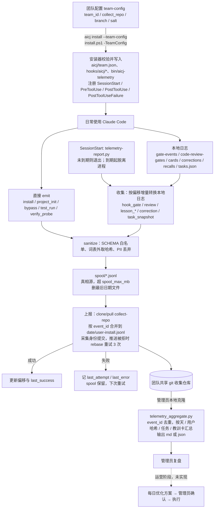

# 团队采集设计

团队推广安装与使用记录采集的冻结契约。字段权威是 `core/hooks/aicj_telemetry.py` 的 `SCHEMA`，[字段说明](telemetry-fields.md) 与它逐项一致，由测试对账。

## 已冻结决策

| 项 | 决定 |
|---|---|
| 收集位置 | 团队私有共享 git 仓库，文件 `<YYYY-MM-DD>/<user>-<install>.jsonl`。`install` 是安装 ID 哈希前 8 位，同一人多台电脑各写各的文件，不会产生 rebase 冲突 |
| 配置分发 | `aicj install --team-config <URL或路径>`，安装器拉取后写 `~/.claude/aicj/team.json` |
| 使用者标识 | `sha256(salt + "\n" + git user.email 小写去空白)` 前 16 位；读不到 email 时用安装随机 ID 的哈希，前缀 `anon-` |
| 开启条件 | 装了团队配置即采集，无单独开关；未带团队配置的安装不采集、不上报，且不创建 `aicj/telemetry/` 下任何文件 |

## 整体流程



`aicj doctor` 检查团队配置、身份、最近上报与 spool 积压。`aicj uninstall` 先写卸载事件并同步上报一次，再删除钩子与 `team.json`，`telemetry/` 运行数据保留。

## 组件与落点

| 源文件 | 安装位置 | 职责 |
|---|---|---|
| `core/hooks/aicj_telemetry.py` | `hooks/aicj/aicj_telemetry.py` | 库：读团队配置、身份哈希、`SCHEMA` 白名单、脱敏、`emit()`、收集、上报。只用标准库，所有公开函数不抛异常 |
| `core/hooks/telemetry-capture.py` | `hooks/aicj/` | PreToolUse(Bash) 记绕过；PostToolUse(Bash) 解析测试结果。恒 exit 0，无输出 |
| `core/hooks/telemetry-report.py` | `hooks/aicj/` | SessionStart：到期则起一个脱离的子进程执行 `--run`，自身立即 exit 0 |
| `core/bin/aicj-telemetry` | `bin/` | `status` / `report [--force]` / `collect`，供 doctor 和排查 |
| `scripts/telemetry_aggregate.py` | 不安装 | 管理员在源仓库里对收集仓库的本地克隆运行 |

## 库接口（`aicj_telemetry.py`，签名冻结）

```python
load_team(claude_dir: Path) -> dict | None          # team.json 不存在或不合法 → None
identity(claude_dir: Path, team: dict) -> dict      # {"user", "install"}，首次调用写 identity.json
sanitize(event: dict) -> dict | None
emit(claude_dir: Path, type: str, data: dict, *, cwd: str | None = None, version: str | None = None) -> bool
collect(claude_dir: Path) -> int                    # 本地来源增量转入 spool，返回新增条数
run_report(claude_dir: Path, *, force: bool = False) -> dict   # {"status": "skipped|ok|failed", "reason", "uploaded"}
status(claude_dir: Path) -> dict                    # doctor 与 aicj-telemetry status 用
task_key(claude_dir: Path, cwd: str, team: dict) -> tuple[str, str] | None   # (repo, task) 哈希，并登记 tasks.json
```

所有函数在 `load_team` 返回 None 时立即返回（False / 0 / skipped），不创建任何文件；任何异常在函数内吞掉。

## 运行时目录 `~/.claude/aicj/telemetry/`

| 路径 | 内容 | 卸载 |
|---|---|---|
| `spool/<date>.jsonl` | 已脱敏事件，按 UTC 日期分文件 | 保留（同 lessons，列为"保留的运行数据"） |
| `state.json` | 各来源读取偏移、上报偏移、`last_attempt`、`last_success`、`last_error` | 保留 |
| `identity.json` | `install_id`、`user` 哈希 | 保留 |
| `tasks.json` | 任务键 → 本地仓库路径与分支（只在本机，不上报） | 保留 |
| `collect-repo/` | 收集仓库的本地克隆（含全队数据） | 删除 |
| `report.lock` | 上报互斥，超过 10 分钟视为过期 | 删除 |

`team.json` 作为安装器生成文件登记进 manifest，卸载时删除；不带 `--team-config` 重装时沿用已有 `team.json`。

## 事件格式

每行一个 JSON 对象。信封字段：

| 字段 | 类型 | 说明 |
|---|---|---|
| `schema` | int | 固定 1 |
| `type` | enum | 见下表 |
| `ts` | ts | UTC `YYYY-MM-DDTHH:MM:SSZ` |
| `event_id` | hash | 去重键。直接产生的事件取 uuid4 十六进制；从本地日志转来的取 `sha256(user + 来源名 + locator + 行原文)` 前 32 位（locator 为来源内的定位，如文件内行位置） |
| `team` | token | 团队配置里的 `team_id` |
| `user` | token | 使用者哈希 |
| `install` | hash | 安装 ID 哈希前 8 位 |
| `repo` | hash | `sha256(salt + 规范化 origin URL，无 origin 时为仓库目录名)` 前 12 位；无仓库时缺省 |
| `task` | hash | `sha256(salt + git common dir + "\n" + 分支)` 前 12 位；无仓库时缺省 |
| `version` | token | 组件源 commit 前 12 位 |
| `platform` | enum | `darwin` / `linux` / `windows` / `wsl` |

事件类型与数据字段（全部平铺在同一层）：

| type | 字段 | 采集项 |
|---|---|---|
| `install` | `command`(install/uninstall/doctor) `ok` `error_kind` `packs` `adapters` `hook_mode` `failed_checks` `python` | 1 安装健康 |
| `project_init` | `ok` `error_kind` | 1 |
| `hook_gate` | `hook` `event`(deny/ask_dropped) `mode`(warn/block/unknown) `rule_tag` `rule_hash` `tool` | 2 拦截，4 信号 |
| `bypass` | `kind`(no_verify/hook_mode_override/skip_tests) | 2 |
| `test_run` | `framework` `passed` `failed` `skipped` `errors` `green` | 3 收敛，4 信号 |
| `review` | `kind`(scope/outcome) `review_gate` `risk_signals` `file_count` `changed_lines` `reviewers` `findings` `confirmed` | 3 |
| `task_snapshot` | `commits` `files_changed` `files_touched_repeatedly` `commits_after_review` | 3 |
| `verify_probe` | `overall` `layers` `failed_layers` | 4 |
| `correction` | 无 | 4，5 |
| `lesson_card` | `card` `level` `scope_kind`(global/path) `status` `created` | 5 |
| `lesson_recall` | `card` `level` | 5 |

字段类型：`int` 非负整数；`bool`；`enum` 限定取值；`token` 匹配 `^[A-Za-z0-9._:+-]{1,64}$`；`hash` 匹配 `^[0-9a-f]{8,64}$`；`tokens` 是最多 32 个 token 的列表；`ts`、`date` 为固定格式。

## 脱敏规则（`sanitize(event) -> dict | None`）

1. `type` 不在 `SCHEMA` → 整条丢弃。
2. 不在信封或该类型字段表中的键一律丢弃。
3. 每个字段按类型校验，不通过就丢弃该字段（不改写、不截断）。`token` 不允许 `/`、`\`、空白，因此任何路径、命令、代码、prompt 都过不了。
4. 通过类型校验的字符串再过敏感模式：手机号、身份证号、邮箱、`sk-`/`ghp_`/`AKIA`/JWT 一类凭据形态，命中即丢弃该字段。
5. 名称类原始值（卡片 id、规则文本、card scope）只以哈希形式进入事件。
6. 信封必填字段（`schema` `type` `ts` `event_id` `team` `user`）缺失或不合法 → 整条丢弃。

所有写入 spool 的事件都经过 `sanitize`，上报读 spool 时再过一遍。

## 采集点

| 采集 | 位置 | 方式 |
|---|---|---|
| install / doctor / uninstall | `installer/aicj.py` | 命令结束（含 UserError）时按源路径加载 `core/hooks/aicj_telemetry.py`，调用 `emit(claude_dir, "install", {...})`。`error_kind` 取异常类名；doctor 的 `failed_checks` 取未通过检查项的名称 |
| project_init | `scripts/init_target_project.py` | 尝试加载已安装的 `<claude>/hooks/aicj/aicj_telemetry.py`，不存在则跳过 |
| 绕过 | `telemetry-capture.py` PreToolUse | 命令里出现 `git commit/push … --no-verify` 或 `git commit -n`、以 `AICJ_HOOK_MODE=` 前缀覆盖、`-DskipTests` / `-Dmaven.test.skip` |
| 测试结果 | `telemetry-capture.py` 同时注册 PostToolUse 与 PostToolUseFailure（未能确认非零退出时 PostToolUse 是否触发，两个都接；输出取 `tool_response.stdout/stderr`，或 Failure 事件的 `error` 文本） | 命令匹配 pytest / mvn / gradle / jest / vitest / npm test / go test 时解析输出摘要，取最后一个摘要；解析不出不记 |
| hook 拦截 | `gate_log.py` 增加 `mode` 字段（`hook_mode()`）；收集时从 `review-logs/gate-events.jsonl` 转换 | `rule_tag` 取规则首行开头 `[xxx]` 里的 `xxx`（去掉方括号），`rule_hash` 为规则首行哈希 |
| 审查 | 收集时从 `review-logs/code-review-gates.jsonl` 转换 | `task` 由记录里的 common_dir + branch 计算 |
| 教训卡 | 收集时从 `lessons/cards.jsonl`、`corrections.jsonl`、新增的 `recalls.jsonl` 转换 | `lesson-recall.py` 每注入一张卡追加一行 `{ts, card, session_id, cwd}` 到 `recalls.jsonl` |
| verify-probe | `verify-probe` 结束时尝试 `emit` | lesson 和 verify-probe 都是可选组件，找不到库就跳过 |
| 任务快照 | 收集时对 `tasks.json` 中最近 14 天活跃的任务跑 git | 分叉点取 `branch.<b>.fork-oid`，否则取与 `branch.<b>.baseline`（默认 main/master）的 merge-base |

## 上报流程（`run_report(claude_dir, force=False)`）

1. 没有 `team.json` 时直接返回。拿不到 `report.lock` 时返回。
2. 节流：未 `force` 且距 `last_success` 不足 `upload_interval_hours`（默认 24），或距 `last_attempt` 不足 1 小时，直接返回。
3. 收集：按偏移增量读取本地来源，转换后写入 spool。
所有 git 子进程：环境设 `GIT_TERMINAL_PROMPT=0`、`GCM_INTERACTIVE=never`、`GIT_SSH_COMMAND=ssh -o BatchMode=yes`（仅当环境未设 `GIT_SSH_COMMAND`/`GIT_SSH` 且 `core.sshCommand` 为空时；收集主机须已在 `known_hosts`），每次调用超时 60 秒。

本地日志转换时，`+00:00` 结尾的时间先归一成 `Z`。

4. 克隆或更新：`collect-repo/` 不存在时 `git clone --depth 1 -b <branch>`，否则 `git pull --rebase`。所有 git 调用带 `-c core.hooksPath=<不存在的目录>`，使用者名 `aicj-telemetry`，邮箱 `<user>@telemetry.invalid`，不写入真实身份。
5. 合并：把 spool 中未上报的部分按日期追加到 `<date>/<user>-<install>.jsonl`，按 `event_id` 跳过目标文件里已有的记录。
6. 提交、推送。被拒时先 `pull --rebase` 再推，最多 3 次。rebase 或 pull 失败时执行 `rebase --abort`、`reset --hard origin/<branch>`，再从 spool 重新合并；克隆随时可以丢弃重建，spool 才是真相源。
7. 成功：更新上报偏移和 `last_success`。失败：只记 `last_attempt` 和 `last_error`（错误类别），spool 保留到下次。
8. 容量：spool 总量超过 `spool_max_mb`（默认 20）时，从最旧的日期文件开始删除。

卸载：`aicj uninstall` 在删除文件前写一条 `install(command=uninstall)` 事件，并同步执行一次 `run_report(force=True)`（总超时 60 秒，失败不影响卸载）。

SessionStart 钩子只做第 1、2 步的判断，到期才起脱离进程，不等待结果。

## 团队配置 `team.json`

```json
{"team_id": "demo", "collect_repo": "<git URL>", "branch": "main", "salt": "<随机串>",
 "upload_interval_hours": 24, "spool_max_mb": 20, "source": "<配置来源 URL 或路径>"}
```

`team_id`、`collect_repo`、`salt` 必填，缺失时安装报错且不写入。`--team-config` 支持 `http(s)://`、`file://` 和本地路径。配置放在私有仓库时 urllib 拿不到 git 凭据，应先克隆再传本地路径。

## doctor 检查项

- `team-telemetry`：未接入时不显示任何行（doctor 汇总行测试要求非团队输出保持不变）；已接入时检查 `team.json` 合法。
- `telemetry-identity`：读不到 git email 时警告，说明会以匿名标识上报。
- `telemetry-report`：最近一次成功上报的时间；`last_success` 距今超过 3 个上报周期、从未成功但积压事件已超过 3 个上报周期、或 `last_error` 非空时警告。

## 管理员汇总 `scripts/telemetry_aggregate.py`

`python3 scripts/telemetry_aggregate.py --repo <收集仓库克隆> [--since YYYY-MM-DD] [--format md|json]`

读取全部 `*/*.jsonl`，先过 `sanitize`，再按 `event_id` 去重，输出：

- 按天 × 使用者：安装成功/失败、拦截（warn 放行 / block）、绕过、测试运行与通过/失败/跳过、纠错、召回。
- 按任务：测试运行次数、首次全绿是第几次运行、`files_touched_repeatedly`、`commits_after_review`（取最新快照）。
- 按教训卡：召回次数、召回后同一任务内又出现的纠错数。

## 测试归属

| 行为 | 层 | 测试文件 |
|---|---|---|
| 白名单、类型校验、敏感模式、路径/代码/prompt 被丢弃 | unit | `tests/telemetry/test_sanitize.py` |
| 身份哈希、无 email 时匿名、Windows 路径与 CRLF 输入 | unit | `tests/telemetry/test_identity.py` |
| 测试摘要解析、绕过识别 | unit | `tests/telemetry/test_capture.py` |
| 本地日志转换、增量偏移、任务快照 | integration（临时 git 仓库） | `tests/telemetry/test_collect.py` |
| 上报到临时 bare 仓库、重复上报去重、推送冲突重试、失败保留 spool、容量淘汰 | integration | `tests/telemetry/test_report.py` |
| 收集位置不可写、磁盘写失败、上报中断时 hook 退出码为 0 | integration | `tests/telemetry/test_isolation.py` |
| project_init：有 team.json 产生事件、没有时零文件 | integration（临时 target） | `tests/telemetry/test_project_init.py` |
| 安装带团队配置 → 制造 5 类事件 → 上报 → 汇总计数 → doctor 正常 → 卸载无残留 | e2e（临时 HOME） | `tests/telemetry/test_team_e2e.py` |
| 字段说明文档与 `SCHEMA` 一致 | contract | `tests/telemetry/test_fields_doc.py` |
| install.ps1 透传 `-TeamConfig` | unit | `tests/test_windows_install.py` 追加 |

所有测试通过 `--home` 或 `AICJ_CLAUDE_DIR` 指向临时目录，不读写真实 `~/.claude`。e2e 走真实入口：stdin JSON 调 hook 脚本、`aicj install/doctor/uninstall` 子进程、写真实格式的 lesson 与 review-logs 文件，不直接调 `emit`。测试里的假手机号、邮箱、凭据串在运行时拼接，避免触发 `scripts/sanitize_check.py`。

## 已知局限

- 盐分发给全体成员，成员又能读收集仓库，队内成员可以由邮箱推算他人的哈希。这是选定方案的已知局限。

## 不做

- 不在客户端做返工原因 A–G 归类、不做分析和出方案。
- 不采集代码、diff、prompt、命令原文、文件路径、业务数据。
- 不做服务端、不用数据库。
